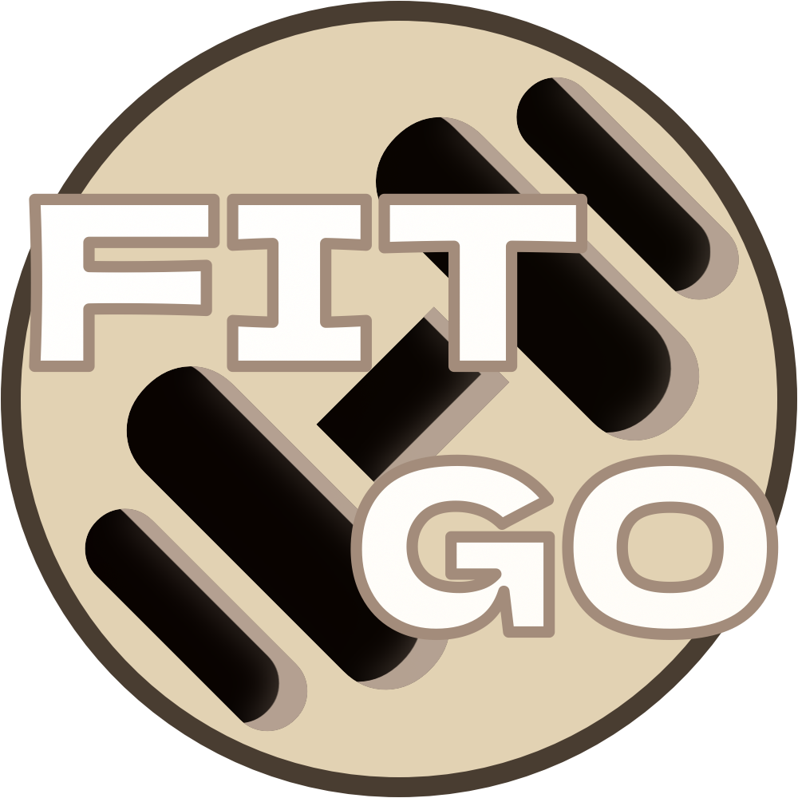
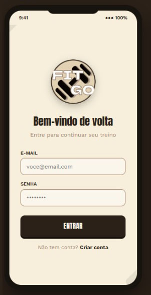
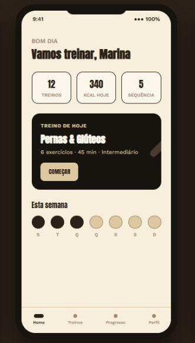
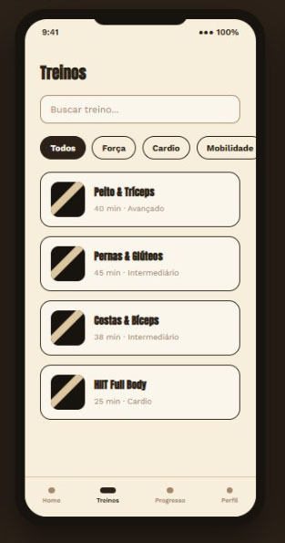
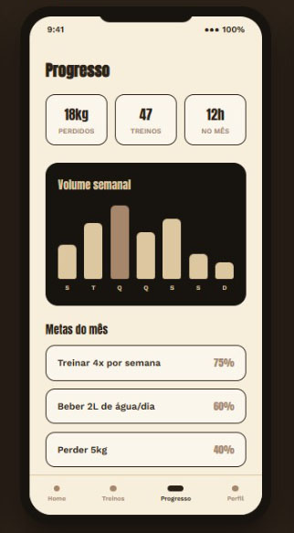
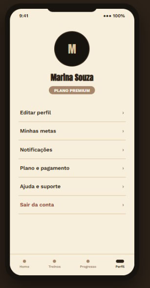

# CHECKPOINT 4 — Idealização do App: FitGo



---

**Integrantes do Grupo e Papéis Fundamentais**

| Membro | Papel | Responsabilidades |
|--------|-------|-------------------|
| **Matheus Taylor (RM556211)** | Product Owner & Documentação | Definição de escopo, documentação e README |
| **Henrique Maldonado (RM557270)** |  QA & Dev Front | Testes manuais, validação de funcionalidades e desenvolvimento da interface e navegação |
| **Yuri Silveira (RM557475)** | UI/UX Designer & Dev Back/Mock| Design no Figma, criação de dados mockados e lógica de negócio |

**Disciplina:** Mobile Development & IoT — 3° Ano — Engenharia de Software

**Professor:** Hercules Ramos**Professor:** Hercules Ramos

# Documentação e Readme do App: FitGo — Treinos com Rotina Personalizada 

## Sobre o Projeto do App

O **FitGo** é um aplicativo mobile desenvolvido em React Native com Expo que oferece rotinas de treino personalizadas com acompanhamento de progresso. O app nasceu da necessidade de democratizar o acesso a treinos de qualidade, combinando inteligência na sugestão de exercícios com uma experiência visual envolvente e motivadora.

## Público-Alvo

Qualquer pessoa que busca iniciar ou manter uma rotina de exercícios físicos de forma prática e acessível, sem a necessidade de personal trainer presencial.

## Tecnologias Utilizadas

- React Native (Expo)
- TypeScript
- EAS Build
- Figma (UI/UX)

## Como Executar O Projeto do App

### 1. Clone o repositório
```bash
git clone https://github.com/MatheusTaylorSimomn2014/fiap-mdi-cp4-fitgo-app
```

### 2. Acesse a pasta
```bash

cd fitgo-mobile
```

### 3. Instale as dependências
```bash
npm install
```

### 4. Execute o projeto
```bash
npx expo start
```

---

## Escopo Do Projeto FitGo

### 1. Problema

Atualmente, grande parte da população enfrenta dificuldades para manter uma rotina de exercícios físicos por falta de:

- **Orientação personalizada** — muitos não têm condições de contratar um personal trainer;
- **Motivação e acompanhamento** — a falta de monitoramento leva à desistência;
- **Organização** — planejar treinos de forma eficiente consome tempo e conhecimento técnico;
- **Acessibilidade** — aplicativos existentes são caros, complexos ou com interfaces pouco intuitivas.

### 2. Público-Alvo

- Jovens, adultos e idosos;
- **Iniciantes** no mundo fitness que precisam de orientação;
- **Praticantes intermediários** que buscam variedade e evolução;
- **Universitários** que conciliam estudos e vida ativa;
- Pessoas que preferem **treinar em casa** ou ao ar livre, sem equipamentos caros.

### 3. Proposta de Valor

O **FitGo** oferece:

1. **Rotinas personalizadas:** Baseadas no nível do usuário, objetivo (emagrecimento, ganho de massa, condicionamento) e disponibilidade de equipamentos.
2. **Acompanhamento de progresso:** Com métricas claras (peso, medidas, carga, repetições).
3. **Interface motivadora e intuitiva:** — design pensado para engajar e simplificar a experiência;
4. **Biblioteca de exercícios:** Com descrições detalhadas e variações para diferentes níveis.
5. **Gamificação:** Conquistas e metas diárias para manter a consistência. (Projeto planejado para o futuro)
6. **Gratuidade com recursos premium:** Modelo freemium que torna o app acessível a todos, mas com recursos extras estando na assinatura premium mensal. (Projeto planejado para o futuro)

### 4. Modelo de Negócio — Freemium

| Plano | Recursos |
|-------|----------|
| **Gratuito** | Acesso à biblioteca de exercícios, criação de até 2 treinos personalizados, acompanhamento básico de progresso, anúncios não invasivos |
| **Premium** (R$ 19,90/mês ou R$ 199,90/ano) | Treinos ilimitados, planos avançados com IA, estatísticas detalhadas, sem anúncios, conteúdos exclusivos (desafios, séries especiais) |

### 5. Diferencial Competitivo

| Concorrente | Limitação | FitGo (diferencial) |
|-------------|-----------|----------------------|
| **Freeletics** | Focado em HIIT, pouca personalização | Rotinas adaptáveis por objetivo e equipamento disponível |
| **Strava** | Foco em corrida/cycling, não em treino de força | Abordagem full-body com variedade de modalidades |
| **MyFitnessPal** | Foco em nutrição, treino é secundário | App centrado em treino com gamificação integrada |
| **SmartFit App** | Restrito a alunos da academia | Disponível para qualquer usuário, independente de vínculo |

**6.Diferenciais FitGo:**

- **Personalização inteligente** — sugestões de treino baseadas em feedback do usuário;
- **Gamificação** — sistema de conquistas e metas que mantém o engajamento;
- **Comunidade** — desafios entre amigos e rankings (em versões futuras);
- **Interface acolhedora** — identidade visual única que reduz a intimidação de quem está começando.

---

## Desenvolvimento de Marca

### 1. Nome do App

**FitGo**

- *"Fit"* remete à forma física, saúde e bem-estar;
- *"Go"* transmite ação, movimento, energia e convite à prática;
- Juntos, expressam a ideia de **"vamos treinar"** de maneira direta e motivadora.

### 2. Logo

A logo do FitGo foi desenvolvida com uma identidade visual que combina **energia** e **equilíbrio**, utilizando formas orgânicas e uma paleta terrosa que remete à natureza e ao movimento corporal.

**Paleta de Cores**

| Elemento | Cor | Hexadecimal |
|----------|-----|-------------|
| Fundo do círculo | Bege | #E9D8AE |
| Texto "FIT GO" | Branco/Off-white | #FDF9F3 |
| Listras diagonais | Preto | #0B0A0A |
| Contorno do texto e borda externa | Marrom | #8B695C |
| Sombra das listras | Bege acinzentado | #B4A390 |

### Tipografia

- **Títulos e destaques:** *Poppins* (bold) — moderna, geométrica e legível;
- **Corpo de texto:** *Inter* ou *Roboto* — excelente legibilidade em dispositivos móveis;
- **Elementos de ação:** *Poppins* (medium) — consistência visual com a identidade da marca.

---

## Identidade Visual no Figma

### 1. Telas Conceituais

As telas abaixo foram desenvolvidas no Figma e representam a visão inicial do aplicativo:

#### Tela 1 — Onboarding (Boas-vindas)



- Fundo com a paleta de cores FitGo (bege/marrom);
- Logo centralizada com animação suave;
- Botão "Começar" em destaque.

#### Tela 2 — Home (Dashboard)



- Saudação personalizada ("Bom dia, [usuário]!");
- Card do treino do dia com resumo;
- Métricas rápidas (treinos concluídos, streak de dias);
- Navegação inferior com ícones (Home, Treinos, Progresso, Perfil).

#### Tela 3 — Treinos



- Lista de treinos disponíveis (categorias: Iniciante, Intermediário, Avançado);
- Cards com nome, duração estimada e nível de dificuldade;
- Botão "Iniciar treino" em cada card.

#### Tela 4 — Progresso



- Gráficos de evolução (peso, carga, repetições);
- Linha do tempo com conquistas desbloqueadas;
- Estatísticas semanais/mensais.

#### Tela 5 — Perfil



- Foto e dados do usuário;
- Configurações de treino (objetivo, nível, equipamentos);
- Planos e assinatura. (ainda não implementado)

### 2. Link do Figma

**URL:** `https://www.figma.com/design/nPn99Enz8a8JLFv88Xz37O/FIT-GO?node-id=0-1&t=T8nc2corT72W0lee-1`

---

## 📄 Licença

Este projeto é desenvolvido para fins acadêmicos — FIAP 3ESPH.

---

# CHECKPOINT 5 — Protótipo Funcional

## O que foi entregue

| Requisito CP5 | Status | Onde |
|---------------|--------|------|
| Protótipo com dados mockados (sem backend) | ✅ | `fitgo-mobile/src/data/mockData.ts` + `src/services/fitgo.ts` |
| Ambiente de testes configurado | ✅ | Jest + jest-expo (`npm test`, 7 testes unitários passando) e roteiro manual abaixo |
| README atualizado no GitHub | ✅ | Este README + `fitgo-mobile/README.md` |
| Telas e fluxos de navegação documentados | ✅ | Seção "Telas implementadas" abaixo |
| Decisões técnicas registradas | ✅ | Seção "Decisões técnicas" abaixo |
| Simulação via emulador/navegador | ✅ | `npx expo start --android` ou `--web` (prints/vídeo anexar na entrega) |

## Telas implementadas e fluxo de navegação

```
Onboarding (splash animada)
   └─► Tabs inferiores: Home | Treinos | Progresso | Perfil
        Home ──► "Iniciar agora" ──► Detalhe do Treino (/treino/[id])
        Treinos ──► card de treino ──► Detalhe do Treino (/treino/[id])
        Progresso: gráfico de carga semanal + conquistas (gamificação)
        Perfil: objetivo, nível, plano Freemium (CTA Premium) e sair
```

- **Home:** saudação dinâmica por horário, card "Treino do Dia" (recomendação personalizada por objetivo/nível com rodízio diário), métricas da semana e streak.
- **Treinos:** lista agrupada por nível (Iniciante/Intermediário/Avançado); tocar em um card abre o detalhe.
- **Detalhe do treino (`/treino/[id]`):** exercícios com séries, repetições, descanso e equipamento.
- **Progresso:** totais da semana, gráfico de barras de carga por dia e conquistas desbloqueáveis.
- **Perfil:** dados do usuário, seletor de objetivo, card do plano Freemium (R$ 19,90/mês) e logout simulado.

## Decisões técnicas

- **Expo SDK 57 + expo-router** — roteamento baseado em arquivos (`src/app`), menos configuração nativa e build simples via EAS.
- **TypeScript estrito** — tipos de domínio em `src/data/types.ts`; checagem com `npm run typecheck`.
- **Camada de serviço isolada (`src/services/fitgo.ts`)** — hoje consome mocks locais; quando existir backend real, basta trocar as importações por chamadas assíncronas mantendo as assinaturas.
- **Jest + jest-expo** para testes unitários da lógica de negócio e integridade dos mocks.
- **react-native-web** — permite simulação/demo direto no navegador além do emulador Android.
- **EAS Build** (`eas.json`, perfil `preview` → APK) para gerar o instalável do CP6.

## Roteiro de testes manuais (CP5)

| # | Passo | Resultado esperado |
|---|-------|--------------------|
| 1 | Abrir o app | Splash animada → Home carregada |
| 2 | Conferir saudação | "Bom dia/Boa tarde/Boa noite, {nome}!" conforme horário |
| 3 | Tocar "Iniciar agora" na Home | Abre o detalhe do Treino do Dia com exercícios |
| 4 | Navegar pela tab bar | Alterna Home/Treinos/Progresso/Perfil sem erros |
| 5 | Filtrar visualmente por nível em Treinos | Cards agrupados Iniciante→Avançado, contagem correta |
| 6 | Abrir um treino intermediário | Lista de exercícios com séries/reps/descanso |
| 7 | Aba Progresso | Métricas da semana batem com o gráfico; conquistas com cadeado/check |
| 8 | Aba Perfil | Objetivo ativo correto; CTA "Assinar Premium" visível p/ não-premium |
| 9 | Rodar `npm test` | 7 testes unitários passando |

# CHECKPOINT 6 — Entrega Final (parcial)

- App funcional com as principais features (recomendação personalizada, catálogo de treinos, progresso/gamificação, perfil/freemium) ✅
- Documentação final (este README + README do app) ✅
- Testes automatizados + roteiro manual ✅
- **APK:** gerado pelo EAS Build com a conta Expo do time: `npx eas-cli build --platform android --profile preview` (configuração pronta em `eas.json`; exige login — ação manual do integrante responsável).

## Desafio bônus (opcional)

Não integrado nesta fase. Candidato natural: API pública de previsão do tempo (OpenWeather) para sugerir treino ao ar livre conforme o clima — ficaria isolada na camada `src/services/`.
